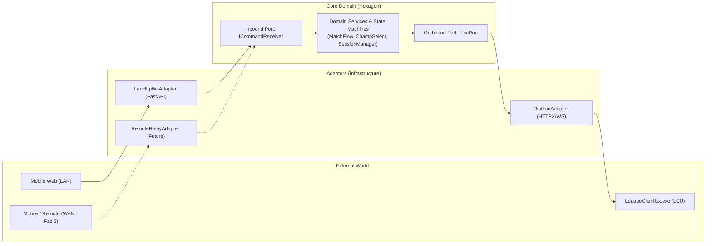

# ADR-0003: Hexagonal Mimari (Ports & Adapters) ve Taşıyıcıdan Bağımsız (Transport-Agnostic) İletişim

## Durum
Kabul Edildi (Accepted)

## Tarih
2026-11-01

## Bağlam (Context)
RiftPilot'ın ilk sürümü (Faz 1) telefon ile bilgisayarın aynı yerel ağda (LAN) doğrudan HTTP/WebSocket üzerinden haberleşmesini şart koşmaktadır. Ancak kesin bir ürün gereksinimi olarak; ilerleyen sürümlerde (Faz 2) farklı internet ağlarından, hücresel mobil veri (4G/5G) üzerinden veya üçüncü parti aktarıcılar (relay/WebRTC) vasıtasıyla uzaktan erişim desteklenecektir.

Eğer uygulama iş mantığı (League of Legends LCU otomasyonu, şampiyon seçimi, sıra kabulü vb.) doğrudan yerel WebSocket/FastAPI yönlendiricilerine sıkı sıkıya bağlanırsa (tight coupling):
1. Gelecekte uzaktan erişim eklendiğinde temel uygulama mantığı ve LCU orkestrasyonu baştan yazılmak veya kopyalanıp çoğaltılmak (code duplication) zorunda kalır.
2. Ağ katmanı ile iş mantığı birbirine karışır; birim test yazmak zorlaşır ve mock'lama karmaşıklaşır.

## Karar (Decision)
RiftPilot çekirdeğinde **Hexagonal Architecture (Ports and Adapters)** mimari deseni uygulanacaktır:

### Temel Prensipler:
1. **Çekirdek Alan Bağımsızlığı (Domain Isolation):**
   - Çekirdek alan katmanı (`Core Domain`); gelen bir `AcceptMatchCommand` veya `SelectChampionCommand` komutunun yerel ağdan mı, internetteki bir aktarıcıdan mı yoksa test çalıştırıcısından mı geldiğini **bilmez ve ilgilenmez**.
2. **Giriş Portu ve Adaptörleri (Inbound Ports & Adapters):**
   - **Inbound Port (`ICommandReceiver` / `IEventBroadcaster`):** Dış dünyadan komut alan ve istemcilere durum olaylarını bildiren soyut arayüz.
   - **Faz 1 Adaptörü (`LanHttpWsAdapter`):** Yerel FastAPI ve WebSocket sunucusunu çalıştırarak mobil cihazla yerel ağda konuşur.
   - **Faz 2 Adaptörü (`RemoteRelayAdapter` / `WebRtcAdapter`):** İleride internet üzerinden güvenli tünel veya aktarıcı protokolünü uygulayarak aynı Inbound Port'u besler.
3. **Çıkış Portu ve Adaptörü (Outbound Ports & Adapters):**
   - **Outbound Port (`ILcuPort`):** LCU ile iletişim sözleşmesi.
   - **LCU Adaptörü (`RiotLcuAdapter`):** Riot istemcisinin `lockfile` dosyasını okuyan, self-signed HTTPS isteklerini atan ve LCU WebSocket olaylarını dinleyen somut altyapı sınıfı.
4. **Taşıyıcıdan Bağımsız Mesaj Zarfı (Transport-Agnostic Message Envelope):**
   - İletişim hangi kanal üzerinden yapılırsa yapılsın, taşınan veri pydantic tabanlı standart bir zarf (`MessageEnvelope`) içerisinde iletilecektir.

## Değerlendirilen Alternatifler

### 1. Monolitik / Doğrudan Rota İçi İşleme (Direct Route Handling)
- **Açıklama:** WebSocket endpoint fonksiyonu içinde doğrudan LCU API çağrısı yapmak.
- **Eksileri:** Hızlı başlar ancak uzaktan erişim geldiğinde tüm mantığı iki farklı yerde yönetmek gerekir. Spagetti koda yol açar.
- **Karar:** Uzun vadeli bakım maliyeti nedeniyle reddedildi.

### 2. Mikroservis Mimarisi (Microservices)
- **Açıklama:** LCU servisi, Auth servisi ve Web servisini ayrı süreçler (processes) veya container'lar olarak çalıştırmak.
- **Eksileri:** Tek bir masaüstü kullanıcısının bilgisayarında çalışacak hafif bir araç için gereksiz süreçler arası iletişim (IPC) karmaşıklığı yaratır (Over-engineering).
- **Karar:** KISS ve YAGNI prensipleri gereği reddedildi.

## Sonuçlar (Consequences)

### Olumlu Kazanımlar:
- **Tam Test Edilebilirlik:** LCU istemcisi ve Web sunucusu olmaksızın, tamamen sahte (mock) portlar üzerinden iş mantığının tüm birim testleri izole koşulabilir.
- **Geleceğe Hazırlık (Remote-Ready):** Faz 2'de uzaktan erişim eklendiğinde LCU entegrasyonuna veya oyun akış mantığına tek bir satır dokunulmayacaktır. Yalnızca yeni bir adaptör yazılacaktır.

### Kabul Edilen Tavizler:
- Birkaç arayüz (Interface/Protocol) ve Pydantic veri sözleşmesi tanımlama gerekliliği (başlangıç için küçük bir tasarım eforu).
