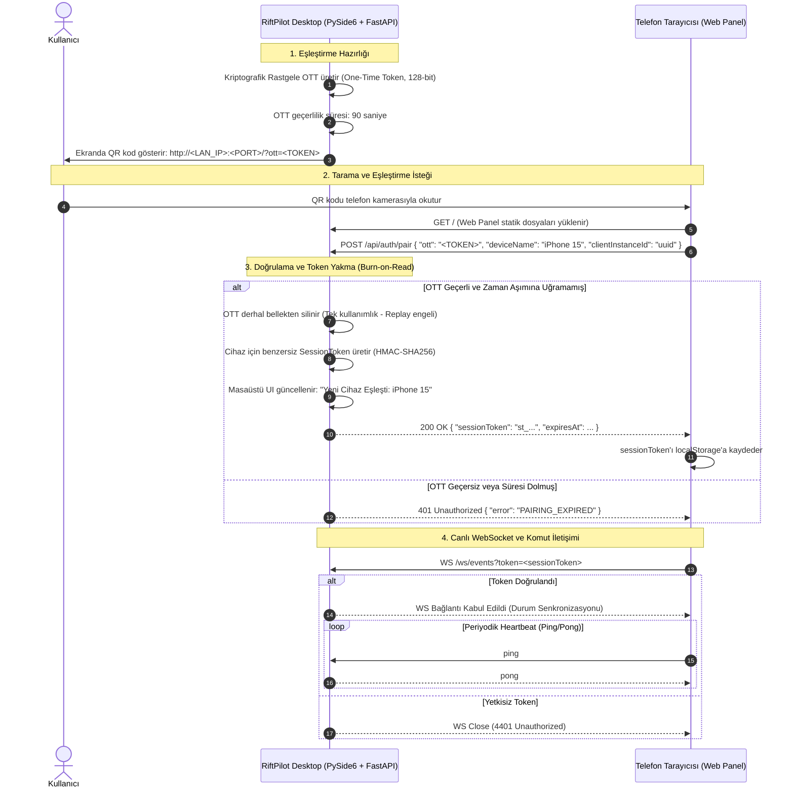

# ADR-0004: QR Kod Tabanlı Eşleştirme ve Cihaz Oturum Güvenliği Modeli

## Durum
Kabul Edildi (Accepted)

## Tarih
2026-11-01

## Bağlam (Context)
RiftPilot'ın ilk sürümünde masaüstü uygulaması ve mobil telefon aynı yerel ağda (LAN) bulunacaktır. Kullanıcı deneyimini pürüzsüz kılmak adına telefona uygulama mağazasından bir app indirtmek yerine, masaüstü ekranındaki QR kodun telefon kamerasıyla taranması ve tarayıcıda açılan web arayüzü ile sistemin kontrol edilmesi istenmektedir.

Bu modelde çözülmesi gereken kritik güvenlik ve operasyonel problemler:
1. **Ağ İçi Yetkisiz Erişim:** Aynı yerel ağda (ev Wi-Fi'ı, yurt veya ofis ağı) bulunan başka kişilerin bilgisayardaki RiftPilot portunu keşfedip yetkisiz oyun komutları göndermesini engellemek.
2. **Replay Attack (Yeniden Oynatma):** Taranan QR kodun bağlantısının başkası tarafından ele geçirilip sonradan kullanılmasını önlemek.
3. **Kopma ve Yeniden Bağlanma (Disconnection/Reconnection):** Telefon ekranı kapandığında veya Wi-Fi sinyali anlık koptuğunda kullanıcının her seferinde baştan QR kod taramak zorunda kalmasını engellemek.
4. **Cihaz Denetimi:** Masaüstü kullanıcısının hangi cihazların bağlı olduğunu görebilmesi ve dilediği cihazın erişimini anında iptal edebilmesi (Revocation).

## Karar (Decision)

İki aşamalı kriptografik eşleştirme ve oturum yönetimi protokolü uygulanacaktır:

### Güvenlik Kuralları:
1. **Tek Kullanımlık Token (OTT - One-Time Token):**
   - QR kod içerisindeki eşleştirme tokenı en fazla 90 saniye geçerlidir.
   - Sunucu tarafından ilk başarılı eşleşme isteği alındığı anda bellekten yakılır (burn-on-read). Replay saldırıları kesin olarak imkansız hale gelir.
2. **Kalıcı Oturum Tokenı (Session Token):**
   - Eşleşme onaylandığında telefona güvenli, yüksek entropili bir `SessionToken` verilir.
   - Telefon arayüzü bu tokenı tarayıcının `localStorage` alanında saklar.
   - Ağ koptuğunda telefon tekrar bağlandığında kullanıcıdan yeni QR kod istenmez; arka planda `SessionToken` ile sessizce yeniden yetkilenir.
3. **Masaüstü Yetki Denetimi & İptal (Revocation):**
   - PySide6 masaüstü arayüzünde "Bağlı Cihazlar" listesi sunulacaktır.
   - Kullanıcı dilediği an masaüstünden *"Yetkiyi Kaldır"* butonuna basarak ilgili cihazın `SessionToken`'ını kara listeye alabilir veya silebilir.
4. **Sıfır Güven (Zero-Trust) Komut Doğrulaması:**
   - WebSocket veya HTTP üzerinden gelen her bir komut paketi (`ACCEPT_MATCH`, `LOCK_CHAMPION` vb.) aktif ve geçerli bir `SessionToken` taşımak zorundadır.

## Değerlendirilen Alternatifler

### 1. Statik PIN / Şifreleme Kodu
- **Eksileri:** Kullanıcının telefonda klavyeden sürekli 6 haneli şifre girmesi gerekir. Zayıf kullanıcı deneyimi; ayrıca yerel ağda kaba kuvvet (brute-force) saldırılarına açıktır.
- **Karar:** QR kodun sağladığı kriptografik entropi ve hız nedeniyle reddedildi.

### 2. Ağ Kısıtlamasız / Kimlik Doğrulamasız İletişim
- **Eksileri:** Aynı Wi-Fi ağındaki herhangi bir cihaz bilgisayara doğrudan POST istekleri atarak maçı bozabilir veya istemciyi kontrol edebilir.
- **Karar:** Kritik bir güvenlik zafiyeti yaratacağı için kesinlikle reddedildi.

### 3. Harici Bulut Sunucu & OAuth (Cloud-based Pairing)
- **Eksileri:** İlk sürüm gereksinimi olan "internetsiz / yerel ağda çalışma" ilkesini bozar; üçüncü parti sunucu maliyeti ve gizlilik endişesi yaratır.
- **Karar:** LAN-first mimarisi gereği ilk aşamada reddedildi.

## Henüz Doğrulanmamış Teknik Ayrıntılar & Araştırma (Spike) İhtiyacı

> [!NOTE]
> Mühendislik ilkelerimiz gereği doğrulanmamış varsayımlar kesin bilgi olarak kabul edilmez:
> - **Mobil Tarayıcılarda Yerel HTTP Davranışı:** Modern mobil tarayıcılar (özellikle Safari iOS ve Chrome Android), `http://192.168.x.x` adreslerini yerel ağda genellikle açabilmektedir; ancak bazı PWA özellikleri (arka plan bildirimleri, titreşim API'si) yalnızca HTTPS (`secure context`) altında çalışabilmektedir.
> - **Yerel SSL Sertifikası Alternatifi:** Eğer mobil tarayıcı yerel HTTP'de kısıtlama uygularsa, masaüstünde geçici bir yerel CA veya self-signed sertifika mekanizması (`mkcert` benzeri) gerekip gerekmeyeceği Milestone 1 kapsamındaki ilk teknik doğrulama (Spike) testinde incelenecektir.

## Sonuçlar (Consequences)
- **Kullanıcı Deneyimi:** Telefon kamerasıyla tek tıkla kurulum; tekrar eden kopmalarda zahmetsiz yeniden bağlanma.
- **Sağlam Güvenlik:** Yetkisiz yerel cihazların komut göndermesi engellenir, replay attack riski sıfırlanır, masaüstünden tam iptal yetkisi sağlanır.
